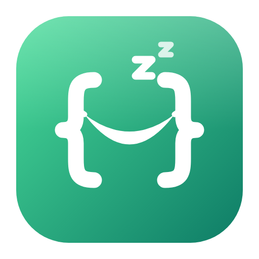
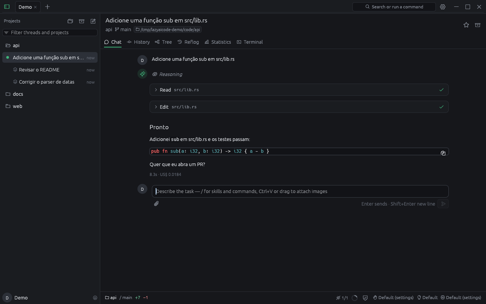
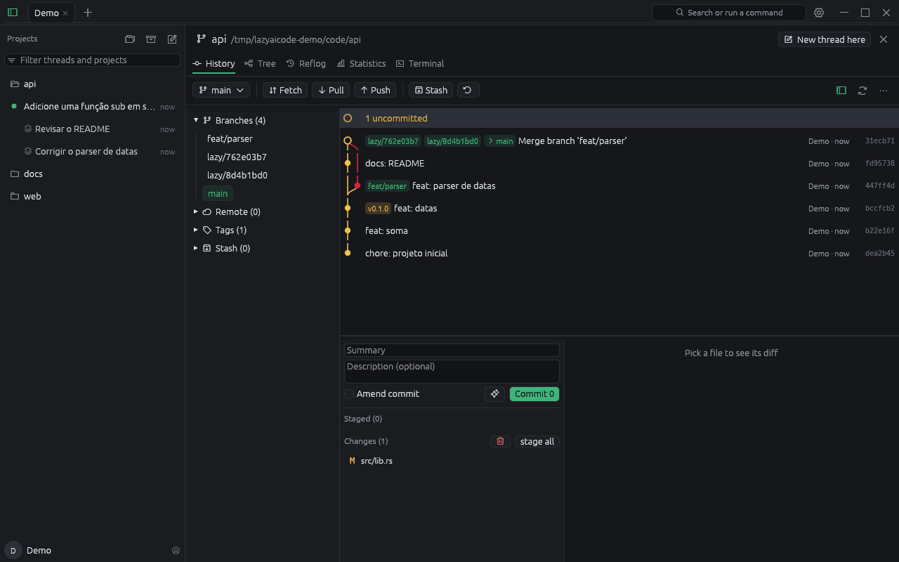

<p align="center"></p>

<h1 align="center">LazyAICode</h1>

<p align="center">
  <b>Um workspace para agentes de código, em Rust puro.</b><br>
  Threads do Claude Code, Codex e Gemini CLI em paralelo, cada uma no seu checkout git isolado,<br>
  com revisão do que o agente mudou, um cliente git completo e um terminal — numa janela nativa desenhada na GPU.
</p>

<p align="center">
  
  
  
  
</p>

<p align="center">
  <a href="#o-que-faz">O que faz</a> ·
  <a href="#feito-para-agentes">Para agentes</a> ·
  <a href="#por-dentro">Por dentro</a> ·
  <a href="#instalar">Instalar</a> ·
  <a href="#compilar">Compilar</a> ·
  <a href="book/src/README.md">Documentação</a>
</p>

<p align="center">
  
</p>

## O que faz

- **Threads em paralelo.** Cada conversa com um agente é uma thread: direto
  na pasta do projeto, ou **isolada** num `git worktree` numa branch própria.
  Nada chega ao projeto até você revisar e integrar.
- **Sem chave própria.** O agente é o `claude` (Claude Code) instalado na
  máquina, com a sua conta — login, assinatura, plugins, skills, MCP e hooks
  são os do terminal. Codex (OpenAI) e Gemini CLI (Google) falam ACP e usam o
  login deles.
- **Workspaces com conta própria.** Um workspace é uma pasta que agrupa
  repositórios e usa um diretório do Claude Code (`~/.claude`,
  `~/.claude-trabalho`…). Cada um é uma aba na barra de título.
- **Revisão do agente.** Os arquivos mudados desde o início da thread, o
  último turno ou o último commit, com o diff e a marca de "revisado" (que se
  desfaz sozinha quando o diff muda). Integrar aplica como mudança local, faz
  merge da branch ou pede um PR ao agente.
- **Git dentro da thread.** Grafo de commits, staging por arquivo, hunk ou
  linha, commit com a mensagem escrita pela IA (com a conta do workspace),
  branches, tags, stash, push/pull/fetch, resolução de conflitos (nosso,
  deles, manual ou pela IA), rebase interativo, cherry-pick, revert, reset,
  blame, histórico de arquivo, comparação de branches, busca, reflog,
  estatísticas, worktrees, remotos, submódulos, LFS e PRs/MRs do GitHub e
  GitLab — no checkout da thread.
- **Terminal** no checkout da thread, com cores, rolagem e copiar/colar.
- **Paleta com tudo** (`Ctrl+K`): threads, pastas e os mais de 500 comandos,
  com formulário automático para os parâmetros.
- **13 temas**, claro/escuro do sistema, quatro idiomas (en, pt, es, zh).

<p align="center">
  
</p>

## Feito para agentes

Cada botão, atalho e menu roda um comando de um único registro. A interface,
a CLI, o canal de controle JSON e o servidor MCP chamam os mesmos comandos —
o que você clica, um script ou um agente de IA também faz.

```sh
# a CLI roda o motor sem janela, com o mesmo estado do app
lazyaicode-cli commands --group thread
lazyaicode-cli run thread.create workspaceId=… projectId=… isolated=true
lazyaicode-cli batch turno.json            # [{command, params}, …]

# um agente dirigindo o LazyAICode por MCP
claude mcp add lazyaicode -- lazyaicode-cli mcp

# o app aberto, por um canal autenticado só em loopback
lazyaicode --control 127.0.0.1:7878
lazyaicode-cli --connect 127.0.0.1:7878 run ui.inspect
```

O MCP traz `thread_send_and_wait`: manda a mensagem e devolve o texto final,
as ferramentas usadas, o custo e o pedido de permissão pendente. Veja
[Automação](book/src/automation/overview.md) e a
[referência de comandos](book/src/reference/commands.md).

## Por dentro

- **Motor primeiro.** Um modelo de documento só com dados e um motor de
  comandos com mais de 500 comandos registrados; a UI egui é uma camada fina
  por cima, que nem liga o motor — fala com ele por comandos. As camadas são
  conferidas no build (`cargo xtask layers`).
- **GPU e CPU.** A janela é egui sobre **wgpu** (Metal, Vulkan, DX12, GL e
  WebGPU), com winit. Um compositor em **CPU** (tiles de 256² em paralelo com
  rayon, PNG via tiny-skia) desenha a mesma saída sem GPU; os dois são
  testados um contra o outro (diferença média de 0,006 por canal).
- **No navegador.** A UI compila para WebAssembly e fala com um
  `lazyaicode-cli serve` por WebSocket; há um `Dockerfile` para hospedar.
- **Endurecido.** Nada de `unsafe` nem de `unwrap` em produção; entrada de
  fora com teto (linhas dos agentes, sessões, quadros, imagens); 12 alvos de
  fuzzing; um "panic hunt" que chama todos os comandos com parâmetros hostis.
  Veja [Segurança](book/src/security/overview.md).

## Instalar

| Sistema | Pacote |
|---|---|
| Windows | `.msi` (app, CLI e agente WSL) |
| macOS | `.dmg` assinado e notarizado (arm64 e x86_64) |
| Linux | `.AppImage`, `.deb`, `.rpm`, `.flatpak`, `.tar.gz` |
| FreeBSD | `.tar.gz` |
| Web | `docker build -t lazyaicode-web .` |

Linux e WSL2, em uma linha:

```sh
curl -fsSL https://raw.githubusercontent.com/filipecrespodev/lazyaicode/main/scripts/install.sh | sh
```

Precisa do [Claude Code](https://docs.claude.com/claude-code) (ou do Codex /
Gemini CLI) e do `git`. Detalhes em [Instalação](book/src/getting-started/installation.md).

## Compilar

```sh
cargo run --release -p lazyaicode      # o app
cargo xtask ci                         # fmt, camadas, i18n, clippy, testes, wasm
cargo xtask web                        # a versão web
cargo xtask dist appimage              # tarball, deb, rpm, appimage, flatpak, dmg, msi, docker
mdbook serve book                      # a documentação
```

| | |
|---|---|
| `crates/` | `platform` `protocol` `i18n` `term` `doc` `git` `agent` `engine` `automation` `render-cpu` `ui-egui` `testkit` |
| `apps/` | `lazyaicode` (desktop) · `lazyaicode-cli` · `lazyaicode-web` (wasm) · `lazyaicode-wsl-agent` |
| `book/` | a documentação (mdBook) |
| `fuzz/` | alvos de fuzzing |
| `packaging/` | AppImage, Flatpak, DMG, MSI, FreeBSD |

Para contribuir, leia o [`AGENTS.md`](AGENTS.md) — vale para pessoas e para agentes.

## Licença

MIT. Veja [`LICENSE`](LICENSE).
